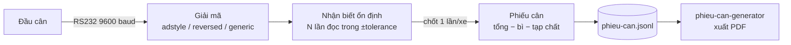

# weighbridge-reader

[](https://github.com/ferbdev-byte/weighbridge-reader/actions/workflows/ci.yml)


Đọc số cân trực tiếp từ **đầu cân điện tử** (cân xe tải, cân bàn) qua cổng COM. Công cụ tự nhận ra lúc cân đã đứng yên, ghép hai lần cân (xe có hàng và xe không) thành **khối lượng hàng**, trừ tạp chất rồi tính tiền. Mục đích là bỏ khâu nhân viên nhìn số trên màn hình rồi gõ tay vào sổ, chỗ dễ sai và dễ bị sửa nhất.

```
$ weighbridge --port COM3 --plate 51C-123.45 --price 8000 --impurity 2 -o phieu-can.jsonl
[08:15:02] 51C-123.45: cân lần 1 = 24.360 kg
[08:31:47] 51C-123.45: cân lần 2 = 9.120 kg
    → hàng 15.240 kg, trừ 305 kg, tính 14.935 kg = 119.480.000 đ
```



## Tính năng

- **Nhiều kiểu bản tin đầu cân**:
  - `ST,GS,+0024360kg`: kiểu A&D và rất nhiều đầu cân khác, có cờ ổn định, tổng/tịnh và quá tải.
  - `=0.06342`: kiểu đảo chuỗi của **XK3190-A9** (chế độ tf=0), chữ số bị gửi ngược.
  - Dạng bất kỳ có số và đơn vị (`kg`, `t`, `g`).
  - `--format auto` tự thử lần lượt các kiểu trên.
- **Nhận biết ổn định** kể cả khi đầu cân không gửi cờ: cần N lần đọc liên tiếp nằm trong ±X kg. Mỗi xe chỉ chốt **đúng một lần**, xe rời cân thì mới sẵn sàng cho lượt sau.
- **Đúng cả hai chiều**: xe vào bán (có hàng → không) hay xe vào mua (không → có hàng) đều tính đúng tổng và bì.
- **Trừ tạp chất** theo %, ra số kg tính tiền và thành tiền.
- **Phiếu cân dạng JSON Lines** để nối sang phần mềm khác, hoặc xuất PDF bằng [phieu-can-generator](https://github.com/ferbdev-byte/phieu-can-generator).
- **Chế độ giả lập** chạy thử khi không có đầu cân.

## Cài đặt

```powershell
pip install "weighbridge-reader[serial] @ git+https://github.com/ferbdev-byte/weighbridge-reader"
```

## Dùng

```powershell
weighbridge --simulate                         # chạy thử, không cần đầu cân
weighbridge --port COM3 --baud 9600            # đọc cân thật
weighbridge --port COM3 --format reversed      # đầu cân XK3190-A9
weighbridge --port COM3 --samples 8 --tolerance 20 --plate 51C-123.45 -o phieu.jsonl
```

Mẹo: xem đầu cân đang ở cổng COM nào trong *Device Manager → Ports (COM & LPT)*. Đa số đầu cân mặc định chạy 9600 baud, 8N1.

## Dùng như thư viện

```python
from weighbridge import parse, StabilityDetector, Ticket
from weighbridge.sources import serial_lines

det = StabilityDetector(samples=5, tolerance_kg=10)
ticket = Ticket("51C-123.45", "Sắt vụn", impurity_pct=2, unit_price=8000)
for line in serial_lines("COM3"):
    reading = parse(line)
    kg = det.feed(reading) if reading else None
    if kg:
        ticket.record(kg)
    if ticket.complete:
        print(ticket.to_dict())
        break
```

## Phát triển

```powershell
pip install -e ".[dev]"
ruff check .
pytest
```

Test phủ các kiểu bản tin, việc chốt số một lần mỗi xe, hai chiều cân, và luồng giả lập từ đầu đến cuối.

## Giấy phép

MIT
